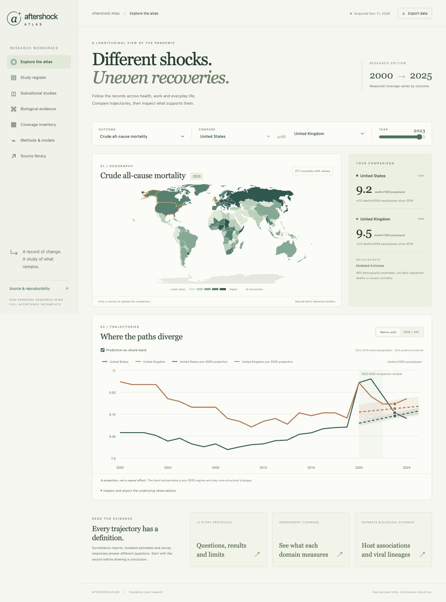

# Aftershock Atlas

A research atlas of pandemic-era trajectories across mortality, employment, economic output, education, health services, surveys, policy and aggregate biological evidence.



## Run

Requires Python 3.13, uv, Node 24, npm and Graphviz. Tested on macOS arm64. Linux correctness and packaging run in CI.

```sh
make bootstrap
make doctor
make data
make panel
make fit
make dynamic
make forecasts
make causal
make studies
make atlas
make demo
```

Open http://127.0.0.1:8765. Select two countries and an outcome, switch to the predictive no-shock band, inspect study S06, then open the subnational and biological evidence views. An exported public snapshot is included for offline browsing after `make build`; acquisition and fitting reproduce the research outputs.

## What runs

The acquired panel contains 851,150 typed records. WHO surveillance has 240 reporting areas. Annual World Bank series contain up to 217 economies, including territories, with explicit missingness. The atlas keeps WHO modeled excess mortality separate from reported COVID deaths, published US survey estimates, two CDC state mortality studies, UK mobility and released HGI aggregate associations.

An original NumPy temporal network is trained from random initialization for three seeds alongside four classical baselines and untrained controls. Sixty version 1 outcome/model configurations have held-out predictions. A separately registered exploratory hierarchical dynamic model adds six configurations and retains losses on three families. A lawful Census public-use replay verifies 80 replicate weights for 74,413 week 1 records; 22 of 24 published-cell comparisons meet the registered tolerance. See [extension results](docs/EXTENSION_RESULTS.md). Some learned point scores improve; interval calibration degrades substantially across the pandemic period. See [findings](docs/FINDINGS.md) and [the thesis](docs/THESIS.md).

**This is a working research preview. Full acceptance is incomplete.** Historical as-of forecasting, complete geography crosswalks, complete survey design auditing, hours and learning outcomes, and several domain requirements remain open. See [build status](docs/BUILD_STATUS.md). The runnable profile is not a substitute for those gates.

## Verification

```sh
make test
make bench
make stress
make docs
make acceptance RUN_ID=my-diagnostic PROFILE=diagnostic
make verify EVIDENCE=evidence/my-diagnostic
```

The independent verifier reads frozen upstream bytes, checks every included measurement, recomputes scores, reconstructs chronological features and replays saved parameters. Thirteen subprocess negative-control recipes exercise rehashed semantic mutations, corruption, missing artifacts, source mismatch and failed replay. Full campaigns use `PROFILE=full` and return nonzero while any mandatory domain gate is incomplete.

## Mechanisms and research

- [Architecture and editable diagrams](docs/ARCHITECTURE.md)
- [Measurement and schema contracts](docs/CONTRACTS.md)
- [Frozen experiment protocol](docs/EXPERIMENT_PLAN.md)
- [Data rights and model card](docs/DATA_RIGHTS.md)
- [Four complete execution walkthroughs](docs/walkthroughs/README.md)
- [Reproduction and recovery](docs/REPRODUCING.md)
- [Evidence format and claim ledger](docs/EVIDENCE.md)
- [Design decisions](docs/adr/README.md)
- [Contributing](docs/CONTRIBUTING.md)

The source is MIT licensed. Datasets keep their own terms, including WHO excess mortality's CC BY-NC-SA 3.0 IGO terms. Public examples and releases contain no participant records or individual genomes. Lawful public-use survey bytes stay in ignored local storage for independent replay. No clinical recommendations or race-as-biology inference are included.
